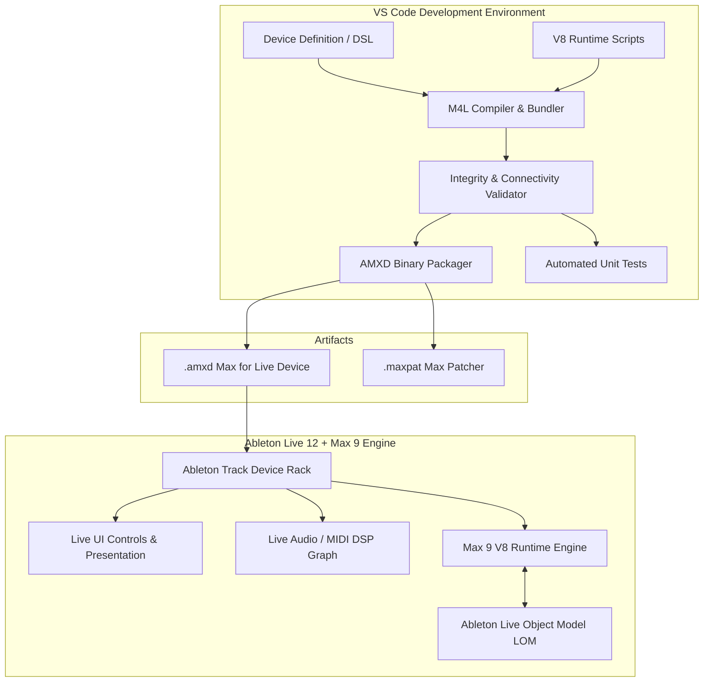

# Architecture: Max for Live Vibe Coding Environment

Documentation Date: 2026-10-13
Status: Initial Architecture and first device prototypes

## System Components

### 1. Patcher Model & Fluent Builder (`src/core/`)
- `Patcher`: Core AST representation of a Cycling '74 Max patcher document.
  - Keeps track of boxes (`boxes`), connections (`lines`), coordinates, and presentation view.
  - Automatically calculates patchcord routing and assigns unique box IDs (`obj-1`, `obj-2`, ...).
  - Handles Live UI parameter configuration (dial ranges, default values, units, script names).
- `AMXDContainer`: Serializer for the 32-byte `ampf` RIFF-like container format used by Ableton Live.
  - Supports `aaaa` (Audio Effect), `mmmm` (MIDI Effect), and `iiii` (Instrument).
  - Packs the JSON patcher with proper byte offsets and null-padding.

### 2. Device Templates (`src/devices/`)
- High-level templates providing standard scaffolding:
  - **M4LAudioEffect**: Sets up `plugin~` stereo inputs, parameter dials, bypass, and `plugout~` stereo outputs.
  - **M4LMidiEffect**: Sets up `midiin`, parser/transformer, and `midiout`.
  - **M4LInstrument**: Sets up `midiin`, synth engine, and `plugout~`.

### 3. Max Runtime JavaScript Engine (`runtime/`)
- Scripts executing inside Max 9's modern JavaScript `v8` object:
  - `lom_helper.js`: Simplifies `LiveAPI` operations (reading song tempo, playhead, track names, clip slots).
  - `vibe_eval.js`: Live code evaluation bridge allowing dynamic box creation and patchcord mutation from messages.
  - `binary_lfo.js`: Generates a random binary value and applies Amount as dropout probability before broadcasting to mapped remotes.

### 4. BinaryLFO (`src/devices/binary-lfo.js`)
- Audio-effect shell passes stereo audio through unchanged; modulation is exclusively Remote Control.
- `live.map` captures up to eight target parameter IDs. Each ID routes to an independent `live.remote~ @normalized 1`, mapping binary 0/1 to the target's minimum/maximum.
- Free rate uses a Hz dial and optional x10 multiplier. Sync mode selects a tempo-relative note division for `metro`.
- The Multimap toggle expands/collapses map slots 2-8. Amount suppresses generated high events; it does not alter the clock rate.
- Automated tests cover AST wiring and dropout endpoints. User reported that BinaryLFO works in Live on 2026-10-12; detailed target-by-target behavior and persistence checks remain unrecorded.

### 5. CLI & Dev Tools (`src/cli/`)
- `m4l-build`: Compiles JavaScript device definitions into `.amxd` and `.maxpat` outputs.
- `m4l-test`: Validates patcher syntax, line references, box positions, and container integrity.
- `m4l-deploy`: Installs compiled devices into Ableton's User Library directory.
- `m4l-watch`: Watches source files and auto-recompiles on save.

### 6. MicroKorgCCMapper (`src/devices/microkorg-cc-mapper.js`)
- MIDI Effect (`mmmm`) parses incoming MIDI with `midiin` and `midiparse`; the control-change list is routed by controller number.
- 47 parameter rows are sourced from `src/devices/microkorg-ccs.js`. There are 40 distinct CC value lanes; aliases such as OSC 2 Semitone and Vocoder HPF level (both CC 18) keep separate Live map targets while sharing the incoming value.
- Each row has `live.map @strict 1` and its own `live.remote~ @normalized 1`. Incoming 0-127 CC values are scaled to 0-1 for parameter min/max.
- A section selector shows one parameter group at a time. The original MIDI stream is wired through the MIDI effect chain; there is no explicit hardware port selection.
- The former `microkorg midi cc map.amxd` and its paired preset were removed after the new uniquely named AMXD was installed and hash-verified.
